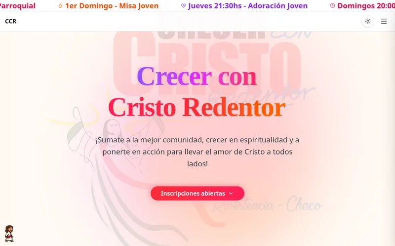
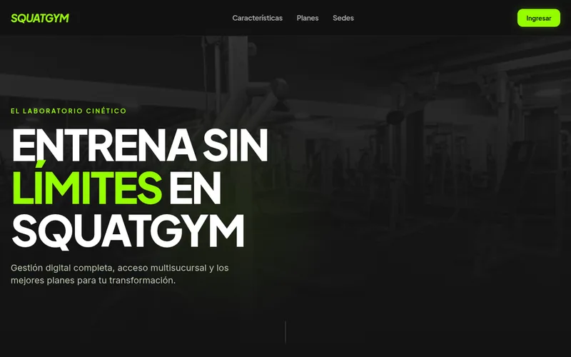

  

  
  
  
  

  Hago sitios web para instituciones de Resistencia. 
  En la facultad programo desde objetos en Pharo hasta assembler 8086; fuera de ella, resuelvo CTFs.

<h2 align="center">Sitios web</h2>

<table>
  <tr>
    <td width="33%" valign="top">
      
      <h4>Instituto de Clínicas IKIGAI</h4>
      
Sitio institucional con un directorio de 14 profesionales en 5 áreas: filtros, buscador y botón de WhatsApp por especialista.

      
<code>HTML</code> <code>CSS</code> <code>JavaScript</code> <code>Schema.org</code>

      
<a href="https://ikigai-alpha-eight.vercel.app">Ver sitio</a> · <a href="https://github.com/sandobaitt/IKIGAI">Código</a>

    </td>
    <td width="33%" valign="top">
      
      <h4>Crecer con Cristo Redentor</h4>
      
Landing de la comunidad juvenil de la Parroquia Asunción. Los voluntarios cargan fechas y novedades desde un CMS, sin tocar código.

      
<code>Next.js</code> <code>TypeScript</code> <code>Tailwind</code> <code>Sanity</code> <code>Framer Motion</code>

      
<a href="https://ccr-landing.vercel.app">Ver sitio</a> · <a href="https://github.com/sandobaitt/ccr-landing">Código</a>

    </td>
    <td width="33%" valign="top">
      
      <h4>SquatGym TP integrador</h4>
      
Prototipo navegable de Gestión de Alumnos y Gestión de Personal (24 casos de uso), con tests de las reglas de negocio.

      
<code>React</code> <code>TypeScript</code> <code>Vite</code> <code>Tailwind</code> <code>Vitest</code>

      
<a href="https://tp-diseno.vercel.app">Ver demo</a> · <a href="https://github.com/sandobaitt/TpDiseno">Código</a>

    </td>
  </tr>
</table>

<h2 align="center">Proyectos de la facultad</h2>

<table>
  <tr>
    <td width="33%" valign="top">
      <h4><a href="https://github.com/sandobaitt/TPI-Paradigmas-">Sistema Dinámico Repulsor</a></h4>
      
Juego de tablero para dos donde las flechas rotan al pasar. TPI de Paradigmas de Programación, en equipo de seis: versión en Pharo con interfaz en Spec y prototipo en Python.

      
<code>Pharo</code> <code>Python</code>

    </td>
    <td width="33%" valign="top">
      <h4><a href="https://github.com/sandobaitt/Assembler">Assembler 8086</a></h4>
      
Resumen de fundamentos y 14 finales resueltos (2022–2026) de Arquitectura de Computadoras, junto con Mariano Del Valle y Paula Kozak.

      
<code>Assembler</code> <code>emu8086</code>

    </td>
    <td width="33%" valign="top">
      <h4><a href="https://github.com/sandobaitt/Ejercicios-Complejidad">Ejercicios de Complejidad</a></h4>
      
Guía y parciales resueltos en Go: recursividad y divide y vencerás.

      
<code>Go</code>

    </td>
  </tr>
</table>

<h2 align="center">Ciberseguridad</h2>

  Resuelvo CTFs y participo en eventos del tema.  
  
  
  

<h2 align="center">Sobre mí</h2>

  Me gusta entender qué pasa debajo de lo que uso, por eso disfruto las materias de bajo nivel, y sigo de cerca lo que sale en inteligencia artificial. 
  Inglés técnico (B1–B2): leo documentación y escribo commits e issues en inglés.

<h2 align="center">Stack</h2>

<table align="center">
  <tr>
    <th align="center">Web</th>
    <th align="center">Lenguajes</th>
    <th align="center">Entorno</th>
  </tr>
  <tr>
    <td align="center"></td>
    <td align="center"></td>
    <td align="center"></td>
  </tr>
</table>

También: Pharo / Smalltalk · Assembler 8086 · PlantUML

<h2 align="center">Ajedrez contra Stockfish</h2>

  Jugás con blancas y Stockfish responde con negras. Elegí una jugada de la tabla: abre un issue ya escrito, y al enviarlo el tablero se actualiza solo.

<!-- CHESS:START -->

<b>Partida 1.</b> Es tu turno: mové una pieza blanca.

Capturaste: — · Stockfish capturó: — · Material: igualado

| Pieza | Destinos: elegí uno y apretá *Submit new issue* |
| --- | --- |
| **♘ b1** | [a3](https://github.com/sandobaitt/sandobaitt/issues/new?title=chess%7Cmove%7Cb1a3%7C0&body=Solo+apret%C3%A1+%22Submit+new+issue%22.+No+hace+falta+escribir+nada+m%C3%A1s.) · [c3](https://github.com/sandobaitt/sandobaitt/issues/new?title=chess%7Cmove%7Cb1c3%7C0&body=Solo+apret%C3%A1+%22Submit+new+issue%22.+No+hace+falta+escribir+nada+m%C3%A1s.) |
| **♘ g1** | [f3](https://github.com/sandobaitt/sandobaitt/issues/new?title=chess%7Cmove%7Cg1f3%7C0&body=Solo+apret%C3%A1+%22Submit+new+issue%22.+No+hace+falta+escribir+nada+m%C3%A1s.) · [h3](https://github.com/sandobaitt/sandobaitt/issues/new?title=chess%7Cmove%7Cg1h3%7C0&body=Solo+apret%C3%A1+%22Submit+new+issue%22.+No+hace+falta+escribir+nada+m%C3%A1s.) |
| **♙ a2** | [a3](https://github.com/sandobaitt/sandobaitt/issues/new?title=chess%7Cmove%7Ca2a3%7C0&body=Solo+apret%C3%A1+%22Submit+new+issue%22.+No+hace+falta+escribir+nada+m%C3%A1s.) · [a4](https://github.com/sandobaitt/sandobaitt/issues/new?title=chess%7Cmove%7Ca2a4%7C0&body=Solo+apret%C3%A1+%22Submit+new+issue%22.+No+hace+falta+escribir+nada+m%C3%A1s.) |
| **♙ b2** | [b3](https://github.com/sandobaitt/sandobaitt/issues/new?title=chess%7Cmove%7Cb2b3%7C0&body=Solo+apret%C3%A1+%22Submit+new+issue%22.+No+hace+falta+escribir+nada+m%C3%A1s.) · [b4](https://github.com/sandobaitt/sandobaitt/issues/new?title=chess%7Cmove%7Cb2b4%7C0&body=Solo+apret%C3%A1+%22Submit+new+issue%22.+No+hace+falta+escribir+nada+m%C3%A1s.) |
| **♙ c2** | [c3](https://github.com/sandobaitt/sandobaitt/issues/new?title=chess%7Cmove%7Cc2c3%7C0&body=Solo+apret%C3%A1+%22Submit+new+issue%22.+No+hace+falta+escribir+nada+m%C3%A1s.) · [c4](https://github.com/sandobaitt/sandobaitt/issues/new?title=chess%7Cmove%7Cc2c4%7C0&body=Solo+apret%C3%A1+%22Submit+new+issue%22.+No+hace+falta+escribir+nada+m%C3%A1s.) |
| **♙ d2** | [d3](https://github.com/sandobaitt/sandobaitt/issues/new?title=chess%7Cmove%7Cd2d3%7C0&body=Solo+apret%C3%A1+%22Submit+new+issue%22.+No+hace+falta+escribir+nada+m%C3%A1s.) · [d4](https://github.com/sandobaitt/sandobaitt/issues/new?title=chess%7Cmove%7Cd2d4%7C0&body=Solo+apret%C3%A1+%22Submit+new+issue%22.+No+hace+falta+escribir+nada+m%C3%A1s.) |
| **♙ e2** | [e3](https://github.com/sandobaitt/sandobaitt/issues/new?title=chess%7Cmove%7Ce2e3%7C0&body=Solo+apret%C3%A1+%22Submit+new+issue%22.+No+hace+falta+escribir+nada+m%C3%A1s.) · [e4](https://github.com/sandobaitt/sandobaitt/issues/new?title=chess%7Cmove%7Ce2e4%7C0&body=Solo+apret%C3%A1+%22Submit+new+issue%22.+No+hace+falta+escribir+nada+m%C3%A1s.) |
| **♙ f2** | [f3](https://github.com/sandobaitt/sandobaitt/issues/new?title=chess%7Cmove%7Cf2f3%7C0&body=Solo+apret%C3%A1+%22Submit+new+issue%22.+No+hace+falta+escribir+nada+m%C3%A1s.) · [f4](https://github.com/sandobaitt/sandobaitt/issues/new?title=chess%7Cmove%7Cf2f4%7C0&body=Solo+apret%C3%A1+%22Submit+new+issue%22.+No+hace+falta+escribir+nada+m%C3%A1s.) |
| **♙ g2** | [g3](https://github.com/sandobaitt/sandobaitt/issues/new?title=chess%7Cmove%7Cg2g3%7C0&body=Solo+apret%C3%A1+%22Submit+new+issue%22.+No+hace+falta+escribir+nada+m%C3%A1s.) · [g4](https://github.com/sandobaitt/sandobaitt/issues/new?title=chess%7Cmove%7Cg2g4%7C0&body=Solo+apret%C3%A1+%22Submit+new+issue%22.+No+hace+falta+escribir+nada+m%C3%A1s.) |
| **♙ h2** | [h3](https://github.com/sandobaitt/sandobaitt/issues/new?title=chess%7Cmove%7Ch2h3%7C0&body=Solo+apret%C3%A1+%22Submit+new+issue%22.+No+hace+falta+escribir+nada+m%C3%A1s.) · [h4](https://github.com/sandobaitt/sandobaitt/issues/new?title=chess%7Cmove%7Ch2h4%7C0&body=Solo+apret%C3%A1+%22Submit+new+issue%22.+No+hace+falta+escribir+nada+m%C3%A1s.) |

Historial, ranking y cómo funciona

**Últimas jugadas**

| Jugada | Quién |
| --- | --- |
| — | — |

**Récord total:** visitantes 0 · Stockfish 0 · tablas 0

**Ranking de visitantes** (jugadas totales)

| Jugadas | Mates | Quién |
| ---: | ---: | --- |
| — | — | — |

Cada link abre un issue con la jugada ya escrita. Un workflow de GitHub Actions la valida, hace que Stockfish (limitado a ~1500 Elo) responda con negras y actualiza este perfil. Si el tablero tarda en cambiar, es la caché de imágenes de GitHub: recargá en un minuto.

Piezas del tablero: Colin M.L. Burnett (CC BY-SA 3.0), vía `python-chess`.

<!-- CHESS:END -->

<h2 align="center">Actividad</h2>

  <picture>
    <source media="(prefers-color-scheme: dark)" srcset="https://raw.githubusercontent.com/sandobaitt/sandobaitt/output/pacman-contribution-graph-dark.svg">
    <source media="(prefers-color-scheme: light)" srcset="https://raw.githubusercontent.com/sandobaitt/sandobaitt/output/pacman-contribution-graph.svg">
    
  </picture>
    
  

